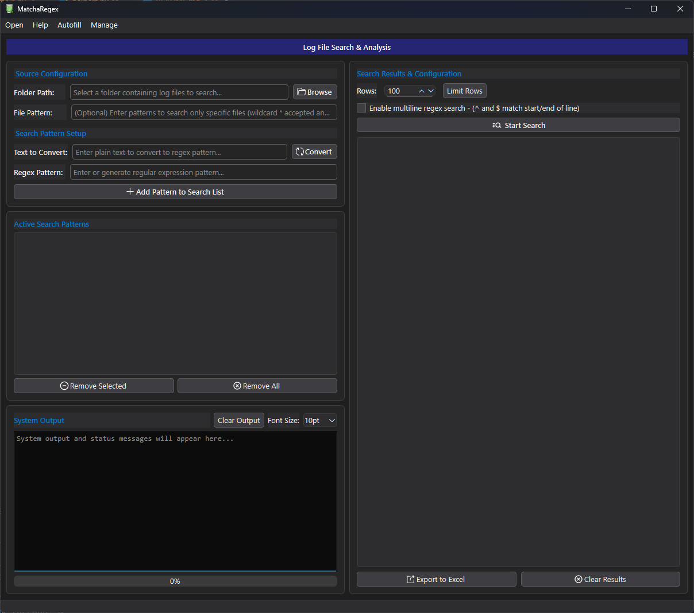

# MatchaRegex - Log File Search & Analysis

MatchaRegex is a desktop application for searching log files with regular expressions and turning the matches into clean tabular data. Named capture groups become table columns, and results can be filtered, counted and exported to Excel or CSV. The UI is built with PySide6.


## Screenshots



## Features

- **Folder & file patterns** – search a folder with comma-separated glob patterns (`*.log, *.txt`, recursive `**/*.log`). Without a pattern, every file in the folder is searched. Binary files are skipped automatically.
- **Named groups → columns** – `(?P<user>\w+)` becomes a `user` column. Every row also contains `File`, `Line`, `Column` and `Pattern`; patterns without named groups fill a `Match` column.
- **Segmentation modes** – decide which text a pattern sees at once:
  - `Line` – every line on its own.
  - `Timestamp` – multi-line log entries starting with a date or time, e.g. `12:00:00`, `2024-05-01 12:00:00`, `01.05.2024`, `[2024-05-01T12:00:00]`, `May  1 12:00:00` (syslog) or `01/May/2024:12:00:00`. Indented lines always continue the current entry.
  - `Exception` – Java/Python exception headers with their stack trace.
  - `Auto` – detected from the first 100 lines of each file.
- **Multiline search** – searches each file as a whole, so patterns can span any number of lines (files over 256 MB fall back to segments).
- **Live results & Stop** – matches appear while the search runs. Searches run in separate worker processes, so the window stays responsive and *Stop Search* works even if a pattern gets stuck in catastrophic backtracking.
- **Parallel processing** – optionally search with multiple processes (half of the CPU cores).
- **Row limit** – stop after a maximum number of matches.
- **Filter & sort** – filter the results table across all columns and sort by any column.
- **Count occurrences** – count how often each value of a column occurs per file.
- **Export** – Excel (`.xlsx`, formatted table) or CSV (comma or semicolon separated, UTF-8 with BOM). Exports contain exactly the filtered and sorted rows you see. Cell content is never turned into Excel formulas.
- **Encoding detection** – UTF-8, UTF-8/UTF-16 with BOM, and latin-1 fallback.
- **Regex builder** – generate a regex from a sample string (IP, email, date, UUID, URL, …).
- **Pattern presets** – save pattern sets, manage them in the *Regex Expression Manager*, and import pattern profiles from JSON.

## Getting Started

### Prerequisites

- Python 3.13+
- [uv](https://docs.astral.sh/uv/) (recommended) or pip

Runtime dependencies are [PySide6](https://pypi.org/project/PySide6-Essentials/) and [XlsxWriter](https://pypi.org/project/XlsxWriter/), declared in `pyproject.toml`.

### Installation

```sh
git clone https://github.com/yourusername/MatchaRegex.git
cd MatchaRegex
uv sync
```

Without uv: `python -m venv .venv`, activate it, then `pip install pyside6-essentials xlsxwriter`.

### Run

```sh
uv run src/main.py
```

## Building a Standalone Executable (Windows)

The app is compiled with [Nuitka](https://nuitka.net/) (installed as a dev dependency by `uv sync`):

```powershell
.\build.ps1 -Clean
```

The result is `build\main.dist\MatchaRegex.exe`. Distribute the whole `main.dist` folder.

| Option | Effect |
| --- | --- |
| `-Clean` | Remove the previous build output first |
| `-IncludeConfig` | Ship your local `src\config` (saved presets) with the build |
| `-Console` | Keep a console window open for debugging |

If no C compiler (Visual Studio Build Tools) is installed, Nuitka downloads one automatically on the first build.

## Alternative Layout (preview)

An alternative, redesigned layout is available next to the classic one. Switch with **View → Alternative Layout** (the app offers to restart), or start it once with:

```sh
uv run src/main.py --alt-ui      # --classic-ui forces the classic layout
```

It uses a card-based layout with a sidebar for patterns and options, a source bar with the primary *Start Search* action, an empty state, a live row counter, and a collapsible output panel. Keyboard shortcuts:

| Shortcut | Action |
| --- | --- |
| `F5` / `Ctrl+Enter` | Start / stop search |
| `Ctrl+O` | Browse folder |
| `Ctrl+L` | Focus regex input (`Enter` adds the pattern) |
| `Ctrl+F` | Filter results |
| `Ctrl+E` | Export |
| `Del` | Remove selected pattern |

Each layout remembers its own window size and splitter positions.

## Usage

1. **Select folder** – *Browse* or paste a folder path. The status bar shows how many files match.
2. **File patterns** – optionally enter patterns such as `*.log,*.txt`.
3. **Build patterns** – type a regex, or convert a sample string, then *Add* it to the list. Invalid patterns are rejected immediately.
4. **Options** – choose the segmentation mode, multiline search, parallel processing and row limit.
5. **Start Search** – results stream into the table. Click the same button again to stop.
6. **Analyse** – filter, sort, or count occurrences of a column.
7. **Export** – choose Excel or CSV in the save dialog.

## Pattern Profile JSON

*Autofill → Import Pattern Profile JSON* loads every string value whose key contains `pattern`:

```json
{
  "default_profile": "errors",
  "base_patterns": { "header_pattern": "Error-log for '(?P<profile>[^']+)'" },
  "profiles": {
    "errors": { "caused_by_pattern": "^\\s*Caused by:\\s*(?P<cause>.*)" }
  }
}
```

Imported profiles are saved as presets in `src/config/config.json`.

## Project Structure

```text
src/
├── main.py                  # Entry point
├── app.py                   # Main window
├── app_paths.py             # File locations (source and compiled build)
├── core/
│   ├── search/engine.py     # Regex search engine (pure Python, runs in worker processes)
│   ├── search/segmenters.py # Streaming Line/Timestamp/Exception segmentation
│   ├── models/              # Qt table model for results
│   ├── analysis/            # Count occurrences
│   └── patterns/            # Regex builder, pattern profiles
├── services/
│   ├── workers/             # Search thread + generic thread-pool worker
│   ├── export/              # CSV / Excel export
│   ├── config/              # JSON config handler
│   └── mixins/, utils/      # Signal wiring, helpers
└── gui/                     # Generated UI, dialogs, assets
```

## Contributing

Contributions are welcome! Please open issues or submit pull requests for improvements.

## License

MIT License

## Acknowledgements

- [PySide6](https://www.qt.io/qt-for-python)
- [XlsxWriter](https://xlsxwriter.readthedocs.io/)
- [Nuitka](https://nuitka.net/)
- [Regex101](https://regex101.com/)
- [RegexLearn Cheatsheet](https://regexlearn.com/cheatsheet)
